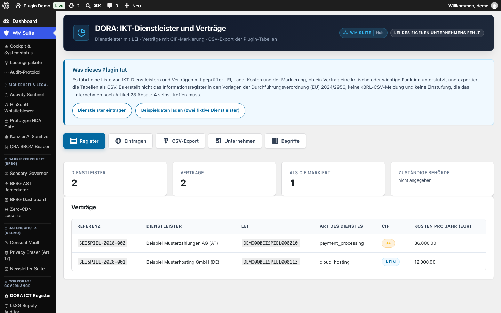
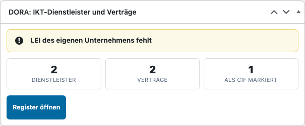

# WM DORA ICT Register (Deutsche Dokumentation)

<p align="center">
  <a href="README.md"></a>
  <a href="README.de.md"></a>
  <a href="README.es.md"></a>
</p>

[](https://www.gnu.org/licenses/gpl-2.0.html)

WordPress-Plugin zur Führung eines Verzeichnisses von IKT-Drittdienstleistern und Verträgen mit validierter LEI, Land, Jahresausgaben sowie einer Kennzeichnung, ob ein Vertrag eine kritische oder wichtige Funktion (CIF) unterstützt, samt CSV-Export der Tabellen.

Erfordert WordPress 6.4 und PHP 8.2. Version 1.2.2 (Plugin-Header). **Plugin-Seite:** [https://arnoldwender.com/wordpress-plugins/wm-dora-ict-register/](https://arnoldwender.com/wordpress-plugins/wm-dora-ict-register/)

Dieses Dokument beschreibt den tatsächlichen Stand laut Code ([README.md](README.md)). Frühere Werbegrafiken wurden am 20.11.2026 außerhalb des Repositorys archiviert (Release 1.2.0).

> **Plugin-Seite:** [https://arnoldwender.com/wordpress-plugins/wm-dora-ict-register/](https://arnoldwender.com/wordpress-plugins/wm-dora-ict-register/)  
> **Mit einem agentischen Workflow entwickelt:** entstanden mit KI-Coding-Agenten. Prüfen und testen Sie es wie jeden fremden Code, bevor Sie es produktiv einsetzen.  
> **Support & Haftung:** Kein Support (Zero Support) — reproduzierbare Bugs ausschließlich über [GitHub Issues](https://github.com/arnoldwender/wm-wp-dora-ict-register/issues) · kein privater Support · OHNE GEWÄHR („AS IS“) / keine Haftung ([SUPPORT.md](SUPPORT.md))

## Live-Vorschau

!WM DORA ICT Register Banner

| IKT-Drittparteien-Register | Dashboard-Widget |
|---|---|
|  |  |

## Was das Plugin leistet

- **Anbieter:** Juristischer Name, LEI (ISO 17442, Prüfziffern validiert), Land (ISO 3166-1 Alpha-2), Mutterunternehmen Ja/Nein, Sicherheitszertifikat Ja/Nein mit optionalem Ablaufdatum. Eine Zeile je LEI.
- **Verträge:** Referenz, Anbieter, Dienstleistungskategorie, Land der Datenhaltung, Unterauftragsvergabe erlaubt Ja/Nein, jährliche Ausgaben in EUR sowie Kennzeichnung, ob der Vertrag eine kritische oder wichtige Funktion (CIF) unterstützt.
- **CIF-Kennzeichnung:** Im Admin-Formular antwortet das Unternehmen mit Ja oder Nein. Über REST sendet der Aufrufer entweder `supports_cif` oder die vier Eingaben einer Bewertungsheuristik (Kernbankdaten, RTO-Stunden, Anzahl Unterauftragnehmer, Kategorie: +40, +30, +20, +15, Vorschlag ab 50 Punkten). Diese Heuristik gehört ausschließlich zum Plugin; weder DORA noch technische Regulierungsstandards definieren eine Punktzahl. Fehlende oder unlesbare Eingaben werden abgewiesen, niemals still als „nicht kritisch“ gespeichert.
- **CSV-Export:** Drei CSV-Dateien (Anbieter, Verträge, Unterauftragnehmer) und ein JSON-Manifest mit Unternehmens-LEI, Name und zuständiger Behörde aus den Einstellungen. RFC-4180-Quoting, CRLF, Neutralisierung von Zellen mit führendem `= + - @`. Downloads in wp-admin, über `wp dora export-csv` und `GET /wp-json/wm-dora/v1/export/csv`.
- **Prüfungen in Admin, Widget und Hub:** Vorhandensein der Tabellen, gesetzte Unternehmens-LEI, Verträge mit fehlendem Anbietereintrag.
- **WP-CLI** `wp dora list`, `wp dora export-csv`, `wp dora cif-audit`, **REST** unter `wm-dora/v1` für Administratoren, **WM-Suite-Hub-Modul** (Status, Telemetrie, `self_test`, `cif_audit`).
- **Entwickler-Hooks & Block-Integrationen:** Filter `wm_dora_export_download_body` und `wm_dora_supplier_row`, Action `wm_dora_ready`, WordPress-6.5+-Block-Bindings-Quelle `wm-dora/metrics` sowie GenerateBlocks-2.x-Dynamic-Tag `{{wm_dora_metric}}`.
- **Opt-in-Deinstallation:** Registertabellen und Unternehmenseinstellungen bleiben bei Deinstallation standardmäßig erhalten, sofern ein Administrator `wm_dora_delete_data_on_uninstall` unter *DORA IKT-Register › Unternehmen* nicht ausdrücklich aktiviert.
- **Übersetzungen:** `.pot`-Katalog aus dem Quellcode sowie kompilierte `.po`- und `.mo`-Übersetzungen für 28 Sprachpakete.
- **Beispieldaten:** Zwei fiktive Anbieter („Beispiel Musterhosting GmbH“, „Beispiel Musterzahlungen AG“) mit LEIs, deren Prüfziffern gültig sind und die nicht bei GLEIF registriert sind.

## Was das Plugin nicht leistet

- **Kein amtliches Informationsregister:** Die Durchführungsverordnung (EU) 2024/2956 legt die Meldebögen B_01.01 bis B_99.01 fest; das Plugin führt drei einfachere Tabellen mit eigenen Spalten.
- **Kein xBRL-CSV-Berichtspaket**, keine Taxonomie, keine Einreichung bei Aufsichtsbehörden.
- **Keine Eingabe für Unterauftragnehmer:** Die Tabelle für Unterauftragnehmer existiert und wird exportiert, besitzt aber kein Formular, keine Route und keinen Befehl zur Befüllung.
- **Keine rechtliche Prüfung**, ob DORA anwendbar ist oder ob eine Funktion kritisch bzw. wichtig ist; Art. 28 Abs. 4 lit. a DORA weist diese Entscheidung dem Finanzunternehmen zu. Siehe [docs/LEGAL-COMPLIANCE.md](docs/LEGAL-COMPLIANCE.md).

## Schnellstart

```bash
wp plugin activate wm-dora-ict-register
wp dora list
wp dora export-csv --output-dir=/tmp/dora-register
```

Hinterlegen Sie anschließend unter *DORA IKT-Register › Unternehmen* die Unternehmens-LEI und erfassen Sie unter *Eintragen* Ihre Anbieter.

## Tests

```bash
php tests/test-suite.php
bash tests/run-mutations.sh
php tests/test-pot-freshness.php
cd tests && ../vendor/bin/phpunit --configuration phpunit.xml.dist
wp eval-file tests/wp-runtime-dora.php --user=1
```

## Bekannte Einschränkungen

- **Installationen mit Beispieldaten von vor dem 15.09.2026** können ältere Demo-Zeilen und einen verwaisten Vertrag enthalten; das Plugin löscht Bestandszeilen nicht automatisch und meldet ohne gültige Unternehmens-LEI `NEEDS_CONFIG` sowie bei verwaisten Verträgen `DEGRADED`.
- **Altdaten werden nicht rückwirkend neu validiert:** Vor dem 15.09.2026 gespeicherte Einträge können ungeprüfte LEIs, `0000-00-00`-Daten (werden leer exportiert) oder lokale Zeitstempel tragen.
- **Multisite (Einzelwebsite-Aktivierung):** Netzwerkaktivierung legt Tabellen auf bestehenden Websites an und `wp_initialize_site` übernimmt automatisch neu angelegte Websites; bei Einzelaktivierung bleibt bei neuen Websites eine manuelle Aktivierung erforderlich.
- **SBOM-Hash** im Hub deckt wie bei den anderen Spokes ausschließlich die Hauptdatei ab.

## Dokumentation

- [README.md](README.md) (englische Referenz)
- [docs/ARCHITECTURE.md](docs/ARCHITECTURE.md)
- [docs/DEVELOPER-GUIDE.md](docs/DEVELOPER-GUIDE.md)
- [docs/LEGAL-COMPLIANCE.md](docs/LEGAL-COMPLIANCE.md)
- [CHANGELOG.md](CHANGELOG.md)

## Lizenz

Lizenziert unter der **GNU General Public License v2.0 or later** (`GPLv2 or later`, SPDX `GPL-2.0-or-later`). Siehe [LICENSE](LICENSE).
