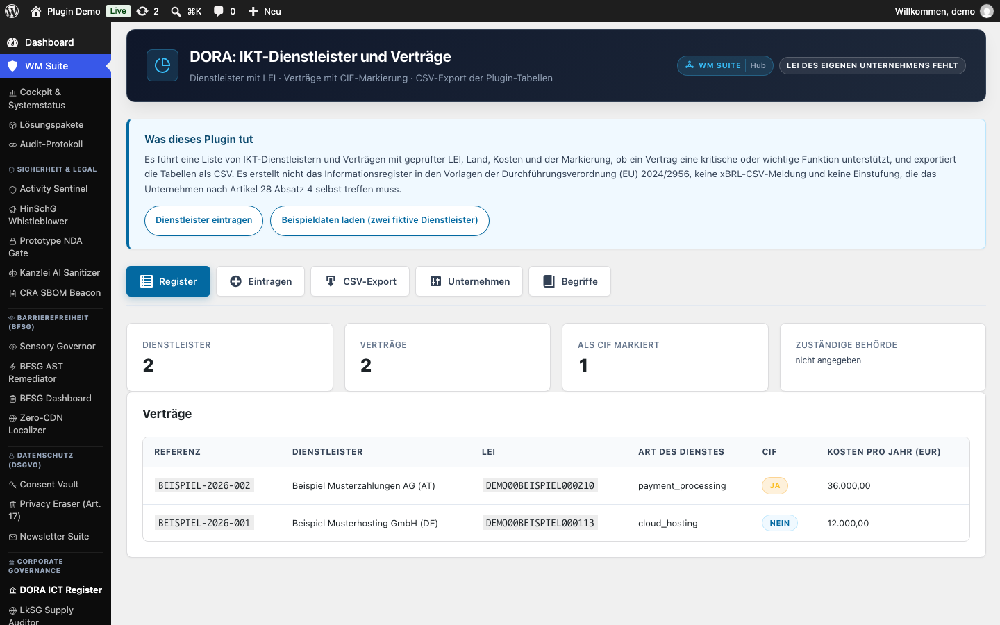
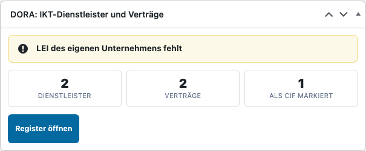

# WM DORA ICT Register (Documentación en Español)

<p align="center">
  <a href="README.md"></a>
  <a href="README.de.md"></a>
  <a href="README.es.md"></a>
</p>

[](https://www.gnu.org/licenses/gpl-2.0.html)

Plugin para WordPress que mantiene un registro de proveedores terceros de servicios TIC y contratos con código LEI validado, país, gasto anual y marcado de soporte a funciones críticas o importantes (CIF), y exporta las tablas en CSV.

Requiere WordPress 6.4 y PHP 8.2. Versión 1.2.2 (cabecera del plugin). **Página del Plugin:** [https://arnoldwender.com/es/plugins-wordpress/wm-dora-ict-register/](https://arnoldwender.com/es/plugins-wordpress/wm-dora-ict-register/)

Este documento describe únicamente lo implementado en el código ([README.md](README.md)). Las imágenes promocionales anteriores se archivaron fuera del repositorio el 20/11/2026 (versión 1.2.0).

> **Página del plugin:** [https://arnoldwender.com/es/plugins-wordpress/wm-dora-ict-register/](https://arnoldwender.com/es/plugins-wordpress/wm-dora-ict-register/)  
> **Desarrollado con un agentic workflow:** creado con agentes de programación de IA. Revísalo y pruébalo como cualquier código de terceros antes de usarlo en producción.  
> **Soporte y responsabilidad:** Cero soporte (Zero Support) — errores reproducibles únicamente en [GitHub Issues](https://github.com/arnoldwender/wm-wp-dora-ict-register/issues) · sin soporte privado · TAL CUAL («AS IS») / sin responsabilidad ([SUPPORT.md](SUPPORT.md))

## Capturas en vivo

!Banner de WM DORA ICT Register

| Registro de Proveedores TIC | Widget del Escritorio |
|---|---|
|  |  |

## Qué hace el plugin

- **Proveedores:** Razón social, LEI (ISO 17442 con verificación de dígitos de control), país (ISO 3166-1 alfa-2), empresa matriz sí/no, certificado de seguridad sí/no con fecha de validez opcional. Una fila por cada LEI.
- **Contratos:** Referencia, proveedor, categoría de servicio, país de ubicación de datos, subcontratación permitida sí/no, gasto anual en EUR y marcado de si el contrato apoya una función crítica o importante (CIF).
- **Marcado CIF:** En el formulario de administración la entidad responde sí o no. Por REST el cliente envía `supports_cif` o los cuatro parámetros de una heurística de puntuación propia del plugin (datos bancarios principales, horas RTO, número de subcontratistas, categoría: +40, +30, +20, +15, sugerencia desde 50 puntos). Ni DORA ni sus normas técnicas definen esta puntuación. Las entradas ausentes o ilegibles se rechazan sin guardarse como no críticas.
- **Exportación CSV:** Tres archivos CSV (proveedores, contratos, subcontratistas) y un manifiesto JSON con el LEI de la entidad, nombre y autoridad competente de los ajustes. Entrecomillado RFC 4180, CRLF y neutralización de celdas que empiezan por `= + - @`. Descargas desde wp-admin, `wp dora export-csv` y `GET /wp-json/wm-dora/v1/export/csv`.
- **Comprobaciones en admin, widget y Hub:** Existencia de tablas, LEI de entidad configurado y contratos cuyo proveedor falta.
- **WP-CLI** `wp dora list`, `wp dora export-csv`, `wp dora cif-audit`, **REST** bajo `wm-dora/v1` para administradores y **módulo WM Suite Hub** (salud, telemetría, `self_test`, `cif_audit`).
- **Hooks y puentes de bloques:** Filtros `wm_dora_export_download_body` y `wm_dora_supplier_row`, acción `wm_dora_ready`, fuente Block Bindings de WordPress 6.5+ `wm-dora/metrics` y etiqueta dinámica de GenerateBlocks 2.x `{{wm_dora_metric}}`.
- **Desinstalación opt-in:** Tablas y ajustes de la entidad se conservan por defecto al desinstalar salvo que el administrador active expresamente `wm_dora_delete_data_on_uninstall` en *DORA IKT-Register › Unternehmen*.
- **Traducciones:** Catálogo `.pot` extraído del código y traducciones compiladas `.po`/`.mo` en 28 locales.
- **Datos de ejemplo:** Dos proveedores ficticios («Beispiel Musterhosting GmbH» y «Beispiel Musterzahlungen AG») con códigos LEI válidos en dígito de control y no registrados en GLEIF.

## Qué no incluye

- **No es el registro de información oficial:** El Reglamento de Ejecución (UE) 2024/2956 define plantillas B_01.01 a B_99.01; el plugin mantiene tres tablas más simples con columnas propias.
- **Sin paquete de reporte xBRL-CSV**, sin taxonomía y sin envío a autoridades competentes.
- **Sin entrada de subcontratistas:** La tabla de subcontratistas existe y se exporta, pero ningún formulario, ruta ni comando escribe en ella.
- **Sin evaluación jurídica** sobre la aplicabilidad de DORA ni sobre si una función es crítica o importante. Véase [docs/LEGAL-COMPLIANCE.md](docs/LEGAL-COMPLIANCE.md).

## Inicio rápido

```bash
wp plugin activate wm-dora-ict-register
wp dora list
wp dora export-csv --output-dir=/tmp/dora-register
```

Configura después el LEI de la entidad en *DORA IKT-Register › Unternehmen* y da de alta proveedores en *Eintragen*.

## Pruebas

```bash
php tests/test-suite.php
bash tests/run-mutations.sh
php tests/test-pot-freshness.php
cd tests && ../vendor/bin/phpunit --configuration phpunit.xml.dist
wp eval-file tests/wp-runtime-dora.php --user=1
```

## Limitaciones conocidas

- **Instalaciones con datos de ejemplo anteriores al 15/09/2026** pueden conservar filas demo heredadas y un contrato huérfano; el plugin no las elimina automáticamente y reporta `NEEDS_CONFIG` hasta fijar el LEI de entidad y `DEGRADED` si hay contratos huérfanos.
- **Las filas existentes no se revalidan:** Registros previos al 15/09/2026 pueden contener LEIs sin validar, fechas `0000-00-00` (exportadas vacías) o marcas horarias locales.
- **Multisite (activación por sitio):** La activación en red crea tablas en los sitios existentes y `wp_initialize_site` provisiona automáticamente sitios nuevos; en activación por sitio individual los nuevos sitios requieren activación manual.
- **El hash SBOM** en el Hub cubre únicamente el archivo principal del plugin.

## Documentación

- [README.md](README.md) (referencia en inglés)
- [docs/ARCHITECTURE.md](docs/ARCHITECTURE.md)
- [docs/DEVELOPER-GUIDE.md](docs/DEVELOPER-GUIDE.md)
- [docs/LEGAL-COMPLIANCE.md](docs/LEGAL-COMPLIANCE.md)
- [CHANGELOG.md](CHANGELOG.md)

## Licencia

Distribuido bajo licencia **GNU General Public License v2.0 or later** (`GPLv2 or later`, SPDX `GPL-2.0-or-later`). Véase [LICENSE](LICENSE).
