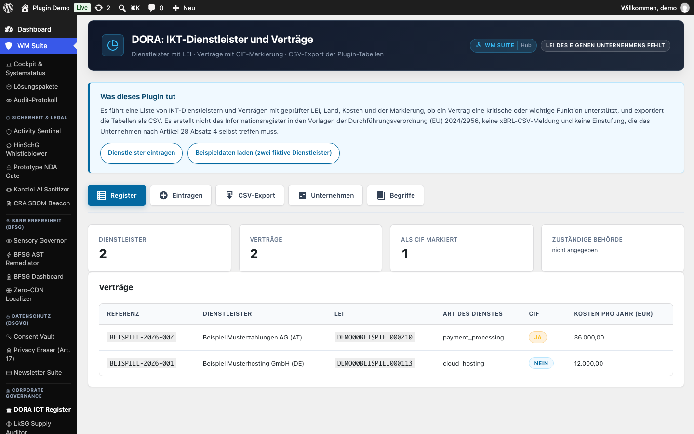
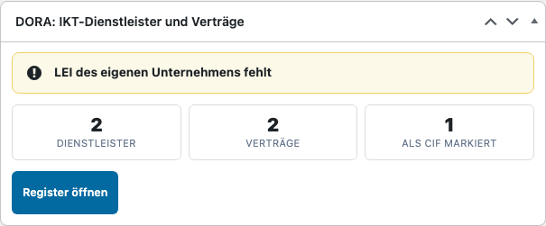

# WM DORA ICT Register

<p align="center">
  <a href="README.md"></a>
  <a href="README.de.md"></a>
  <a href="README.es.md"></a>
</p>

[](https://www.gnu.org/licenses/gpl-2.0.html)

WordPress plugin that keeps a list of ICT third-party service providers and contracts with a validated LEI, country, spend and a marking whether a contract supports a critical or important function, and exports the tables as CSV.

Requires WordPress 6.4 and PHP 8.2. Version 1.2.2 (plugin header). **Plugin Page:** [https://arnoldwender.com/wordpress-plugins/wm-dora-ict-register/](https://arnoldwender.com/wordpress-plugins/wm-dora-ict-register/)

This README was written from the code. An earlier edition promised an "Official xBRL-CSV Packager" for EBA/BaFin submissions, a "Multi-Tier Subcontractor Graph", a "Concentration Risk Heatmap" and "Schrems II" coverage, and referenced two promotional images that were archived outside the repository on 2026-11-20 (release 1.2.0).

> **Plugin page:** [https://arnoldwender.com/wordpress-plugins/wm-dora-ict-register/](https://arnoldwender.com/wordpress-plugins/wm-dora-ict-register/)  
> **Built with an agentic workflow:** developed with AI coding agents. Review and test it like any third-party code before you use it in production.  
> **Support & Liability:** Zero support — reproducible bugs on [GitHub Issues](https://github.com/arnoldwender/wm-wp-dora-ict-register/issues) only · no private support · AS IS / no liability ([SUPPORT.md](SUPPORT.md))

## Showcase

!WM DORA ICT Register banner

| ICT Provider & Contract Register | Dashboard Widget |
|---|---|
|  |  |

## What the plugin does

- **Suppliers.** Legal name, LEI (ISO 17442, check digits verified), country (ISO 3166-1 alpha-2), parent undertaking yes/no, security-certificate yes/no with an optional validity date. One row per LEI.
- **Contracts.** Reference, supplier, service category, data location country, subcontracting permitted yes/no, annual spend in EUR, and whether the contract supports a critical or important function (CIF).
- **CIF marking.** In the admin form the entity answers yes or no. Over REST the caller either sends `supports_cif` or the four inputs of a scoring heuristic (core banking data, RTO hours, number of subcontractors, category: +40, +30, +20, +15, suggestion from 50 points). The heuristic is the plugin's own; neither DORA nor its technical standards define a score. Missing or unreadable input is refused, never stored as "not critical".
- **CSV export.** Three CSV files (suppliers, contracts, subcontractors) and a JSON manifest with the entity LEI, name and competent authority from the settings. RFC 4180 quoting, CRLF, cells starting with `= + - @` neutralised. Downloads in wp-admin, `wp dora export-csv`, `GET /wp-json/wm-dora/v1/export/csv`.
- **Checks in the admin, widget and hub:** tables present, entity LEI set, contracts whose supplier row is missing.
- **WP-CLI** `wp dora list | export-csv | cif-audit`, **REST** for administrators, **WM Suite Hub module** (health, telemetry, `self_test`, `cif_audit`).
- **Developer hooks and block integrations:** filters `wm_dora_export_download_body` and `wm_dora_supplier_row`, action `wm_dora_ready`, WordPress 6.5+ Block Bindings source `wm-dora/metrics`, and GenerateBlocks 2.x Dynamic Tag `{{wm_dora_metric}}`.
- **Opt-in uninstall:** register tables and entity settings are preserved on plugin deletion by default unless the administrator explicitly enables `wm_dora_delete_data_on_uninstall` under *DORA IKT-Register › Unternehmen*.
- **Translations:** `.pot` catalog extracted from source plus compiled `.po` and `.mo` translations across 28 locales.
- **Example data:** two fictional suppliers ("Beispiel Musterhosting GmbH", "Beispiel Musterzahlungen AG") with LEIs that pass the check digits and are not registered at GLEIF.

## What it does not do

- **Not the register of information.** Commission Implementing Regulation (EU) 2024/2956 lays down templates B_01.01 to B_99.01 (entity maintaining the register, entities in scope, contractual arrangements, providers and subcontractors in B_05.01, supply chain in B_05.02, functions, assessments). The plugin keeps three simpler tables with its own columns.
- **No xBRL-CSV report package**, no taxonomy, no filing to a competent authority.
- **No subcontractor input.** The subcontractor table exists and is exported, but no form, route or command writes to it.
- **No legal assessment** of whether DORA applies or whether a function is critical or important; Art. 28(4)(a) leaves that to the financial entity. See [docs/LEGAL-COMPLIANCE.md](docs/LEGAL-COMPLIANCE.md).

## Quick start

```bash
wp plugin activate wm-dora-ict-register
wp dora list
wp dora export-csv --output-dir=/tmp/dora-register
```

Then set the entity LEI under *DORA IKT-Register › Unternehmen* and enter providers under *Eintragen*.

## Tests

```bash
php tests/test-suite.php          # standalone: validation, CIF heuristic, writes, CSV, admin, hub, hooks, bridges, REST, CLI, uninstall
bash tests/run-mutations.sh       # each entry in tests/mutations.php undoes one fix; the suite must turn red
php tests/test-pot-freshness.php  # every string the code translates has an entry in the .pot (needs wp-cli)
cd tests && ../vendor/bin/phpunit --configuration phpunit.xml.dist
wp eval-file tests/wp-runtime-dora.php --user=1   # inside WordPress; its one write is rolled back
```

CI runs PHPUnit and both standalone suites on PHP 8.2 and 8.3, and the catalog freshness and mutation checks on 8.3.

## Known limitations

- **Installs that loaded pre-2026-09-15 example data** may still hold legacy demo rows and an orphan contract. The plugin does not delete existing rows automatically; health reports `NEEDS_CONFIG` until the entity LEI is set and `DEGRADED` for any orphan contract.
- **Existing rows are not re-validated.** Rows stored before 2026-09-15 may carry unchecked LEIs, `0000-00-00` dates (exported as empty) or site-time timestamps.
- **Multisite (per-site activation):** network activation creates tables for all existing sites and `wp_initialize_site` provisions them automatically for sites added later while network-active; if the plugin is activated per site instead of network-wide, new sites still require manual activation.
- **SBOM hash** in the hub covers the loader file only, like the other spokes.

## Documentation

- [docs/ARCHITECTURE.md](docs/ARCHITECTURE.md): classes, tables, flows
- [docs/DEVELOPER-GUIDE.md](docs/DEVELOPER-GUIDE.md): WP-CLI, REST, hooks, block integrations, hub, tests
- [docs/LEGAL-COMPLIANCE.md](docs/LEGAL-COMPLIANCE.md): what the plugin covers of DORA and the register ITS, with sources
- [CHANGELOG.md](CHANGELOG.md)

## License

Licensed under the **GNU General Public License v2.0 or later** (`GPLv2 or later`, SPDX `GPL-2.0-or-later`). See [LICENSE](LICENSE) and <https://www.gnu.org/licenses/gpl-2.0.html>.
